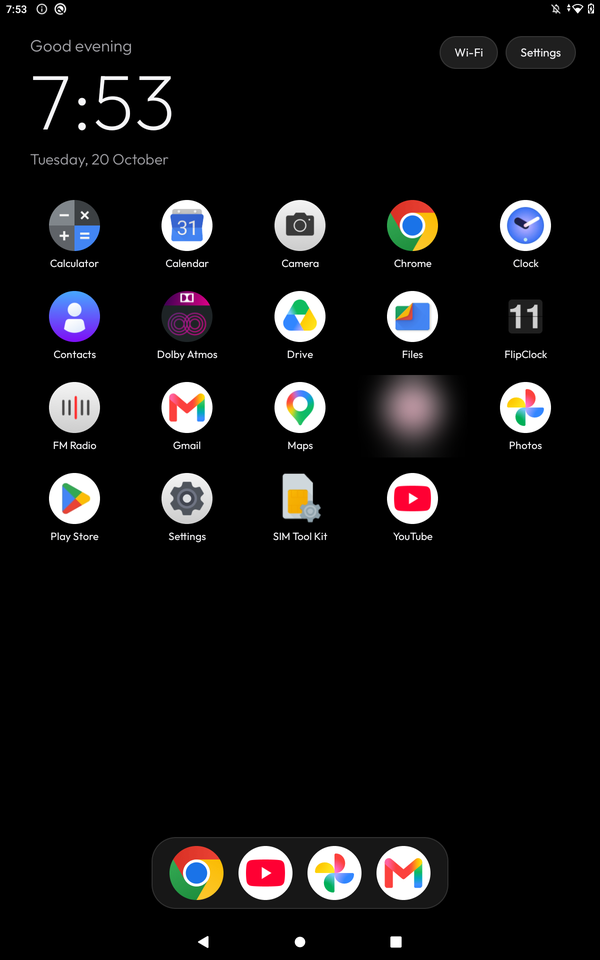
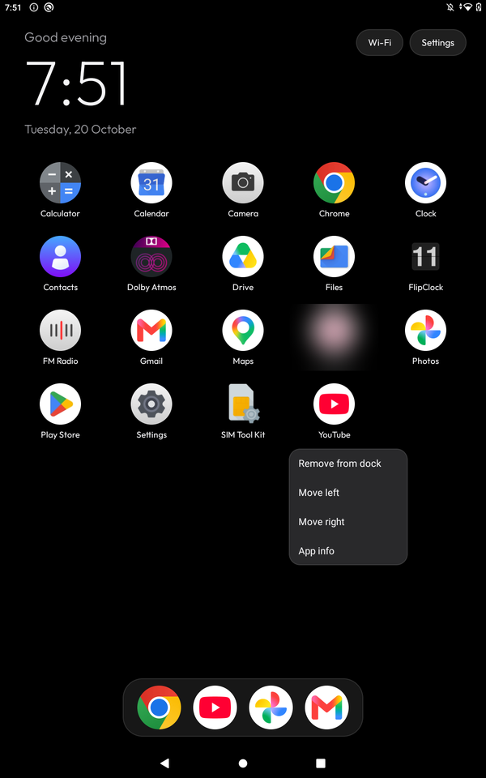

# Clean Your Android

[](https://github.com/Bhargi777/cleanyourandroid/actions/workflows/ci.yml)
[](LICENSE)

**Debloat any Android phone or tablet over ADB, and swap the cluttered home screen for a clean,
iPadOS-style launcher. No root, nothing uninstalled, one command to undo.**

<p align="center">
  
  &nbsp;&nbsp;
  
</p>

Phones and tablets ship with telemetry, content feeds that are really ad slots, partner app
installers, demo modes and preloaded games. This repo gives a coding assistant (Claude Code, Codex,
Gemini CLI, ...) everything it needs to find that junk on *your* device, ask you about anything you
might use, switch it off in small verified batches, and install a light home screen.

## How it works

1. **Back up**: package lists, disabled packages, getprop, every settings table, the Home owner and
   the Recents provider (`tools/backup.sh`).
2. **Disable** manufacturer telemetry, ad/content feeds, auto-installers, demo apps and the preloads
   you don't use with `pm disable-user --user 0`, five at a time with a screenshot in between
   (`tools/disable.sh`). Nothing is uninstalled.
3. **Install** Slate Home, a small native launcher, and make it the default home screen
   (`launcher/build-and-install.sh`).
4. **Undo** any time with `tools/restore.sh`.

## Quick start

| | |
|---|---|
| **1. On the device** | Settings → About → tap **Build number** 7 times → Developer options → **USB debugging** on. Plug in a data cable. |
| **2. On your computer** | Install `adb` (`brew install android-platform-tools` on macOS). Open this repo in your coding assistant and paste [`PROMPT.md`](PROMPT.md) with your model filled in. |
| **3. Follow along** | Tap **Allow** (tick *Always allow*) on the device, then answer the checklists: which apps you use, which ones go in the dock, black or wallpaper. |

Prefer to drive it yourself? If your model is in [`examples/`](examples/):

```sh
tools/backup.sh
tools/disable.sh examples/<your-device>/debloat.txt
launcher/build-and-install.sh        # needs JDK 17 + Android SDK 35
tools/close-adb.sh
```

## What you get

- **A pitch-black home** with a greeting, a thin clock and the date in
  [Outfit](https://fonts.google.com/specimen/Outfit).
- **A dock** of 4–6 apps in a rounded glass band. Long-press to add, remove or reorder.
- **An app grid** that fits the screen: 5 columns on a portrait tablet, 9 in landscape.
- **Frosted Wi-Fi and Settings pills**. The Wi-Fi pill names the network when Location is on.
- **Optional wallpaper**: drop `wallpaper.jpg` in `Android/data/dev.slate.launcher/files/`.
  It is dimmed so text stays readable.
- **Light**: no blur, no video, no network access, no polling. Package changes refresh the grid
  through a broadcast.
- **Optional ad-blocking DNS** (`tools/private-dns.sh on`) that switches itself back off when the
  network blocks DNS-over-TLS.

## Safety rails

`tools/disable.sh` never touches, whatever a list says:

- SystemUI, Settings, telephony, Bluetooth, NFC, the package installer, the permission controller,
  Play Store, Play Services and WebView (the full list is `protected_packages` in `tools/lib.sh`).
- The keyboard you are using, so you can still type your PIN after a reboot.
- The app that owns Home, until another launcher is installed.
- The app that provides **Recents**. On Android 10 and newer that is usually the stock launcher's
  Quickstep, and disabling it breaks app switching.

Lists are refused outright if any line is not a bare package name, because each entry ends up in a
shell command on the device.

## Supported devices

Anything running Android 10 (API 29) or newer that lets you set another app as Home. Tested lists,
one folder per model, live in [`examples/`](examples/):

- Lenovo Tab M10 FHD Plus LTE (TB-X606V), Android 10

Got a different phone or tablet working? Add its list; see [CONTRIBUTING.md](CONTRIBUTING.md).

## Known limits

- **Gesture navigation**: Android 10–12 only allow gestures with the stock launcher, so the device
  switches to 3-button navigation while Slate Home owns Home.
- **Recents** stays with the stock launcher, so that launcher stays enabled (it only starts when
  you open Recents).
- **Work profiles** are not shown in the grid yet.
- Some manufacturers block sideloading or third-party launchers. The debloat half still works.

More in [docs/TROUBLESHOOTING.md](docs/TROUBLESHOOTING.md).

## Repository layout

| Path | What |
|---|---|
| `PROMPT.md` | The prompt to paste into your coding assistant |
| `tools/` | `backup`, `disable`, `restore`, `screenshot`, `private-dns`, `close-adb` |
| `examples/` | Tested debloat lists, one folder per device |
| `launcher/` | Slate Home source (Java, minSdk 29, targetSdk 35) |
| `docs/` | Troubleshooting and screenshots |
| `tests/` | List and tool checks (`python3 -m unittest discover -s tests`) |

Your device's backups and records go to `backup/` and `state/`, which are git-ignored. Never commit
them: they list your installed apps and settings.

## Licence

MIT. Outfit is under the SIL Open Font License (`launcher/app/src/main/assets/fonts/OFL.txt`).

## Credits

Inspired by [CleanYourTV](https://github.com/Gathin23/cleanyourtv/tree/main), this project brings
the idea to Android phones and tablets: touch instead of a D-pad, and Recents and gesture
navigation instead of HDMI inputs.
